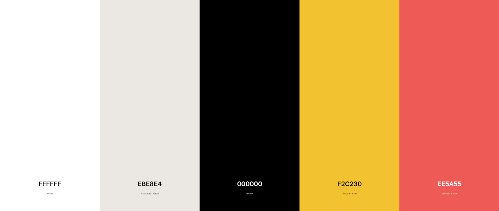
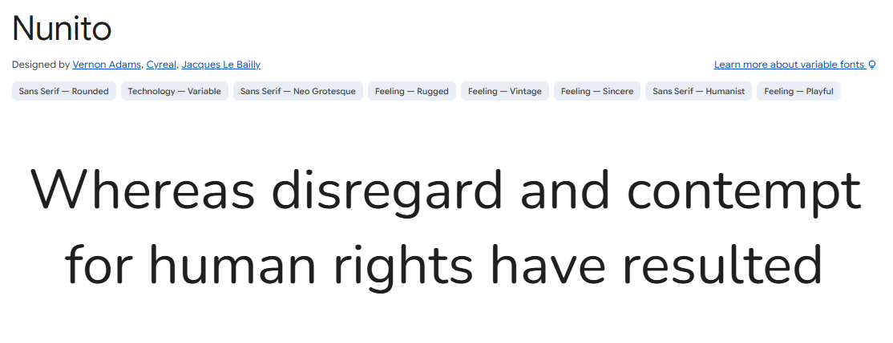

<h1 align="center">Umochi</h1>


The Umochi site is live, please [CLICK HERE](https://dloshch.github.io/Umochi/#) to check the website.

## Tabel of Contents
- [Tabel of Contents](#tabel-of-contents)
- [UX](#ux)
  - [Site Purpose](#site-purpose)
  - [Audience](#audience)
- [Design](#design)
  - [Colour Scheme](#colour-scheme)
  - [Typography](#typography)
  - [Imagery](#imagery)
- [Features](#features)
  - [Existing Features](#existing-features)
  - [Future Features](#future-features)
- [Testing](#testing)
  - [Validator Testing](#validator-testing)
  - [Unfixed Bugs](#unfixed-bugs)
- [Technologies Used](#technologies-used)
  - [Main Languages Used](#main-languages-used)
- [Deployment](#deployment)
  - [How to deploy](#how-to-deploy)
  - [How to clone](#how-to-clone)
- [Credits](#credits)
  - [Content](#content)
  - [Media](#media)
  - [Acknowledgements](#acknowledgements)

## UX

### Site Purpose

Purpose of the Umochi website is to let user find what they are looking for in the shortest amount of time while providing easy to read navigations

### Audience

Target Audience of Umochi is younger people aged between 18 and 30, because younger people are more active on the internet but anyone who is willing to pay is welcome, for the main audience Umochi offers a good contrast of calm pastel colors and bright colors to keep their attention and guide the user through the website to accomplish the user task.

## Design

### Colour Scheme

Umochi uses a standart colour scheme for the market it targets:

<details>
<summary>Colour Scheme</summary>

- #FFFFFF - Main Colour
- #EBE8E4 - Background Colour
- #000000 - Text & Icons Colour
- #F2C230 - Main Accent Colour
- #EE5A55 - Secondary Accent Colour



</details>

### Typography

Umochi uses only one decorative rounded font at the moment, without using any standarterized one

<details>
<summary>Fonts</summary>

```
<link rel="preconnect" href="https://fonts.googleapis.com">
<link rel="preconnect" href="https://fonts.gstatic.com" crossorigin>
<link href="https://fonts.googleapis.com/css2?family=Nunito:ital,wght@0,200..1000;1,200..1000&display=swap" rel="stylesheet">
```



</details>

## Features

### Existing Features

### Future Features

## Testing

### Validator Testing
  
### Unfixed Bugs

## Technologies Used
### Main Languages Used

### Frameworks, Libraries & Programs Used

## Deployment
### How to deploy

 ### How to clone

## Credits

### Content

### Media

### Acknowledgements
